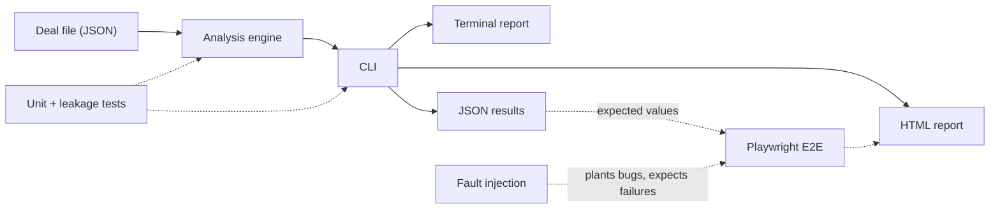

# Test Plan: Main Street Deal Analyzer

[](https://github.com/dpar449/mainstreet-deal-analyzer/actions/workflows/tests.yml)

- **Product:** Main Street Deal Analyzer 1.0.0, a Python CLI that values small businesses for purchase and produces HTML reports
- **Owner:** Daniel Park
- **Last updated:** October 6, 2026
- **Test automation:** Python `unittest`, pytest, Playwright for Python, axe-core
- **CI:** GitHub Actions on every push and pull request ([workflow](.github/workflows/tests.yml))

## At a glance

The analyzer has 221 automated tests at three levels, and all of them pass. The 54 unit and integration tests check the math, input handling, and data-leakage rules, and they run on Python 3.9 through 3.13. Above them, 167 Playwright cases (38 scenarios) open the generated reports in a real browser. Those cases check that the reports show the right numbers, draw charts to scale, work on phones and in dark mode, meet WCAG 2.1 AA, and can't run injected code or make network requests.

To show the tests catch real bugs, a fault-injection script plants 13 realistic defects in a copy of the code. The suite catches all 13. Testing found 11 product defects. All 11 are fixed, and 10 have automated regression tests (see the [defect log](#9-defect-log)).

| Level | Tool | Tests | Runtime |
|---|---|---|---|
| Unit and integration | `unittest` | 29 | ~1 s |
| Leakage and data integrity | `unittest` | 22 | ~10 s |
| Plan traceability | `unittest` | 3 | <1 s |
| End-to-end browser | Playwright + pytest | 167 cases / 38 scenarios | ~40 s |
| Fault injection | `scripts/fault_injection.py` | 13 planted faults | ~55 s |

## 1. Purpose and scope

This plan covers how the analyzer is tested, what is and isn't covered, and the evidence that it works. It also serves as a record of the defects testing found.

**In scope**

- The analysis engine: earnings normalization, five valuation methods, price guidance, SBA 7(a) financing, cash-flow projections, risk scoring
- Input loading and validation: JSON deal files, number formats, error messages
- The CLI commands: `analyze`, `compare`, `offer`, `quick`, `new`, `industries`
- The HTML reports (single deal and comparison): content accuracy, charts, layout, themes, print, keyboard use, accessibility, security
- Data leakage: asking-price anchoring, look-ahead, state shared between runs, data leaving the machine

**Out of scope**

- Whether the valuation model gives the "right" answer for a real business. That's a financial judgment, not a testable fact. Tests check that the documented rules are applied consistently and correctly.
- Currency of market data (prime rate, SBA rules, industry multiples). These are dated constants with a review note in the README.
- Manual screen-reader testing (see [known gaps](#11-known-gaps-and-next-steps)).

## 2. System under test



The engine is pure Python with no third-party dependencies. The CLI writes three outputs from one analysis. The HTML report is a single static file with inline CSS and SVG charts, no JavaScript, and a Content Security Policy that blocks scripts and network access.

## 3. Approach

**Risk-based priorities.** Test effort follows what would hurt a user most. A buyer who sees a wrong number could overpay by six figures, so content accuracy gets the deepest coverage.

| Risk | Impact | Likelihood | Covered by |
|---|---|---|---|
| R1. The report shows a number that differs from the engine's result | High | Medium | E2E-CON-01 to 11, E2E-CMP-01 to 02 |
| R2. A chart misrepresents the values (wrong scale or proportions) | High | Medium | E2E-CHT-01 to 05 |
| R3. The valuation is anchored on the asking price or financing terms | High | Medium | Leakage unit tests (section 6) |
| R4. Text in a deal file runs as code when the report is opened | High | Low | E2E-SEC-02 to 04, E2E-INT-04 |
| R5. A report sends data off the machine or loads remote content | High | Low | E2E-SEC-01, E2E-SEC-05, leakage unit tests |
| R6. The report is unusable on a phone or when printed | Medium | Medium | E2E-LAY-01 to 07 |
| R7. A keyboard or screen-reader user can't use the report | Medium | Medium | E2E-A11Y-01 to 04, E2E-INT-02 |
| R8. A bad input crashes the tool or is silently misread | Medium | Medium | Input-error unit tests |

**The engine is the test oracle.** Every report under test is produced by running the real CLI in a subprocess with `--json`. The browser tests then compare what the page shows against those JSON results. This catches a classic reporting bug: correct math, wrong number on screen. Expected display strings come from a small independent formatter in the test code, not from the product's own formatting functions.

**Tests target behavior, not styling.** Selectors use `data-testid` attributes and ARIA roles, so restyling the report doesn't break the suite.

**Every page runs under a guard.** The `open_report` fixture blocks all network traffic, then fails the test if the page made a request, logged a console error, threw an exception, or opened a dialog. Any new test gets these checks for free.

**The tests are tested.** Fault injection (section 8) plants defects and confirms the suite fails. A suite that passes against broken code proves nothing.

## 4. Test environment

| Item | Value |
|---|---|
| CI runner | GitHub Actions, `ubuntu-latest` |
| Python | 3.10, 3.12, 3.13 in CI (unit); 3.12 (E2E). 3.9 and 3.11 also verified locally |
| Browser | Chromium (Playwright 1.56.0, browser build 1194), headless |
| Viewports | 320, 375, 768, 1024, 1280, 1440 px wide |
| Color schemes | Light, dark, explicit theme override, print media |
| Network | Blocked for every report page |
| Accessibility engine | axe-core (bundled with `axe-playwright-python` 0.1.8), WCAG 2.0/2.1 A and AA plus best-practice rules |

## 5. Test data

| Data set | Source | Why it's included |
|---|---|---|
| HVAC services | `examples/hvac_services.json` | Healthy, growing business (grade A, "Negotiable") |
| Laundromat | `examples/laundromat.json` | Strong business, but debt coverage below the lender minimum |
| Marketing agency | `examples/marketing_agency.json` | Owner-dependent, heavy add-backs, five red flags, overpriced |
| All-cash deal | Generated in `e2e/conftest.py` | No debt, so debt sections must disappear cleanly |
| Unprofitable business | Generated | Earnings below the owner's salary, single summary-only period |
| Hostile input | Generated | Script tags, HTML, quotes and a `javascript:` URL in every text field |
| Linked listing | Generated | A valid `https` listing link |
| Offer-price run | HVAC at `--price 1.5M` | The "your price" mode instead of asking price |
| Comparison | The three examples via `compare` | Ranking and cross-report consistency |

## 6. Test cases

### 6.1 End-to-end browser tests (Playwright)

Each ID is the first line of a test's docstring, and `tests/test_traceability.py` fails the build if this table and the code ever disagree.

| ID | Scenario | Cases |
|---|---|---|
| **Content accuracy** — `e2e/test_report_content.py` | | |
| E2E-CON-01 | Page title and H1 show the business name | 3 |
| E2E-CON-02 | Verdict banner shows the engine's verdict and headline | 3 |
| E2E-CON-03 | Price, walk-away, opening offer, grade, DSCR and IRR tiles match the engine | 3 |
| E2E-CON-04 | Every report section is present, visible and in the documented order | 3 |
| E2E-CON-05 | Risk flags by severity and title match the engine | 3 |
| E2E-CON-06 | Earnings table has one row per period with the engine's revenue and SDE | 3 |
| E2E-CON-07 | Priority checklist items come from this deal's flags, in order | 3 |
| E2E-CON-08 | Year-by-year table covers the hold period with matching free cash and debt | 3 |
| E2E-CON-09 | A report run at the buyer's own price labels it and still shows the asking price | 1 |
| E2E-CON-10 | An all-cash deal shows no debt coverage tile, DSCR grid or loan table | 1 |
| E2E-CON-11 | A business that can't pay the owner's salary gets the most severe verdict | 1 |
| **Charts** — `e2e/test_charts.py` | | |
| E2E-CHT-01 | Valuation chart draws one mark per method, each with a tooltip showing its value | 3 |
| E2E-CHT-02 | Bars, midpoints and price markers sit on one consistent dollar scale (within 1.5 px) | 3 |
| E2E-CHT-03 | SDE column heights are proportional to SDE (within 2%) | 3 |
| E2E-CHT-04 | Year-1 waterfall starts at SDE, ends at free cash, and the steps add up | 3 |
| E2E-CHT-05 | Hovering a chart mark highlights it | 1 |
| **Layout and themes** — `e2e/test_layout.py` | | |
| E2E-LAY-01 | No report scrolls sideways at 320–1440 px (9 reports × 5 widths) | 45 |
| E2E-LAY-02 | On a phone, wide tables scroll inside their own container instead of being clipped | 1 |
| E2E-LAY-03 | Headline tiles reflow on small screens and never overflow | 2 |
| E2E-LAY-04 | Reports follow the system light/dark setting with at least 7:1 body text contrast | 2 |
| E2E-LAY-05 | An explicit theme setting overrides the system setting, both ways | 1 |
| E2E-LAY-06 | Print uses a white page and exports to a multi-page PDF | 1 |
| E2E-LAY-07 | On desktop screens, no single-deal report table needs sideways scrolling (8 reports × 2 widths) | 16 |
| **Interaction** — `e2e/test_interaction.py` | | |
| E2E-INT-01 | Clicking checklist text ticks and unticks its box | 1 |
| E2E-INT-02 | The checklist can be completed by keyboard alone, with a visible focus ring | 1 |
| E2E-INT-03 | A web listing link doesn't leak the report's address to the site | 1 |
| E2E-INT-04 | Reports contain no script tags and no inline event handlers | 1 |
| **Accessibility** — `e2e/test_accessibility.py` | | |
| E2E-A11Y-01 | No WCAG 2.1 A/AA or best-practice violations from axe-core (9 reports × light/dark × phone/desktop) | 36 |
| E2E-A11Y-02 | One H1, and heading levels never skip | 2 |
| E2E-A11Y-03 | Every chart has a text alternative, and its data also appears in a table | 1 |
| E2E-A11Y-04 | Verdicts and flags carry a text label and icon, not color alone | 1 |
| **Security and privacy** — `e2e/test_security.py` | | |
| E2E-SEC-01 | Opening a report makes zero network requests and logs no errors | 9 |
| E2E-SEC-02 | Script and HTML in deal fields display as plain text and never run | 1 |
| E2E-SEC-03 | A `javascript:` listing URL is dropped instead of becoming a link | 1 |
| E2E-SEC-04 | If markup got past escaping, the CSP still blocks scripts, images and stylesheets from outside | 1 |
| E2E-SEC-05 | The rendered report contains no local file paths | 1 |
| **Comparison report** — `e2e/test_compare.py` | | |
| E2E-CMP-01 | Every deal is listed, ranked by verdict, then quality, then IRR | 1 |
| E2E-CMP-02 | Each comparison row matches that deal's own analysis | 1 |
| | **Total** | **167** |

### 6.2 Unit, integration and leakage tests

| File | What it covers | Tests |
|---|---|---|
| `tests/test_mainstreet.py` | Loan math against known values, standby seller notes, IRR, number parsing, SDE build-up, weighted earnings basis, SBA equity-injection rules, debt capacity solving to the target DSCR, input validation and error messages, all CLI commands | 29 |
| `tests/test_leakage.py` | Asking price, offer price and financing terms don't move value; forward assumptions don't change history or lender sizing; results don't depend on run order; inputs are never mutated; every command works with the network blocked; no secrets, paths or comment fields reach outputs; memory and file handles stay flat over repeated runs | 22 |
| `tests/test_traceability.py` | This plan and the code list the same E2E tests and faults | 3 |

## 7. Requirements traceability

| Requirement | Tests |
|---|---|
| REQ-01. Reports show exactly the values the engine computed | E2E-CON-01 to 08, E2E-CMP-02 |
| REQ-02. Charts are drawn to scale and labeled with values | E2E-CHT-01 to 04 |
| REQ-03. Special cases render correctly (offer price, all-cash, unprofitable) | E2E-CON-09 to 11 |
| REQ-04. Reports are readable from 320 px phones to desktop | E2E-LAY-01 to 03, E2E-LAY-07 |
| REQ-05. Reports support light, dark and print | E2E-LAY-04 to 06 |
| REQ-06. Reports meet WCAG 2.1 AA and are keyboard operable | E2E-A11Y-01 to 04, E2E-INT-01 to 02 |
| REQ-07. Reports work offline and never contact a server | E2E-SEC-01, E2E-SEC-05, leakage unit tests |
| REQ-08. Untrusted text can't execute or create unsafe links | E2E-SEC-02 to 04, E2E-INT-03 to 04 |
| REQ-09. Comparison ranks deals consistently with individual reports | E2E-CMP-01 to 02 |
| REQ-10. Value isn't anchored on asking price or financing terms | Leakage unit tests |
| REQ-11. SBA 7(a) structure follows SOP 50 10 8 equity rules | Unit tests (financing) |
| REQ-12. Bad input fails with a clear message instead of a wrong answer | Unit tests (input errors) |

## 8. Fault injection

`scripts/fault_injection.py` copies the repository to a temporary folder, plants one defect, and runs only the tests that should catch it. A fault counts as caught when those tests fail. The working tree is never touched.

| Fault | Planted defect | Caught by | Result |
|---|---|---|---|
| F01 | HTML escaping removed | E2E-SEC-02 | Caught |
| F02 | Content Security Policy removed | E2E-SEC-04 | Caught |
| F03 | Walk-away tile shows the opening offer | E2E-CON-03 | Caught |
| F04 | Grid shrink rule removed (reintroduces D-01) | E2E-LAY-01 | Caught |
| F05 | Walk-away marker drawn 5% off scale | E2E-CHT-02 | Caught |
| F06 | Link color reverted to low contrast (reintroduces D-08) | E2E-A11Y-01 | Caught |
| F07 | Table regions not keyboard-focusable (reintroduces D-07) | E2E-A11Y-01 | Caught |
| F08 | Web-font import added to the stylesheet | E2E-SEC-01 | Caught |
| F09 | Comparison ranking reversed | E2E-CMP-01 | Caught |
| F10 | Unsafe-URL filter removed (reintroduces D-05) | E2E-SEC-03 | Caught |
| F11 | Chart hover highlight removed | E2E-CHT-05 | Caught |
| F12 | Checklist checkboxes lose their labels | E2E-INT-01 | Caught |
| F13 | Risk-table column widths reverted (reintroduces D-11) | E2E-LAY-07 | Caught |

**Result: 13 of 13 caught.** One lesson came out of building this. F08 first reported "missed." The cause turned out to be the planted fault, not the tests: CSS ignores an `@import` that comes after other rules, so the page never made the request and there was nothing to catch. Moving the import to the top of the stylesheet made it a real defect, and the suite caught it right away. The unit leakage tests also catch both versions, because they reject any `url(` in report HTML.

A second lesson came later. After the D-11 fix, F07 suddenly reported "missed." The axe scan only ran at desktop width, and axe only flags table wrappers that actually scroll. Once the desktop tables fit, nothing scrolled, so the scan couldn't see the keyboard problem anymore, even though phone users would still hit it. The scan now runs at phone and desktop widths, and F07 is caught again. Without fault injection, that coverage loss would have gone unnoticed, since every test was still green.

## 9. Defect log

Severity: **High** blocks a user or produces a wrong or unsafe result. **Medium** degrades the experience or a secondary result. **Low** is cosmetic or a best practice.

Every defect was fixed in the product, not by loosening a test. All but D-03 now have an automated regression test.

| ID | Severity | Defect | Found by | Fix · regression test |
|---|---|---|---|---|
| D-01 | Medium | Single-deal reports scrolled sideways on phones because grid columns wouldn't shrink below their content | Visual review, 390 px | Columns use `minmax(0, 1fr)` · E2E-LAY-01, F04 |
| D-02 | Medium | The comparison table cut off its Verdict column | Visual review, 1100 px | Wider comparison layout · E2E-LAY-01 |
| D-03 | Medium | A CSS class name collision gave a table column the page container's padding, stretching every row | Visual review | Renamed the class · none yet (see gaps) |
| D-04 | High | Shortening the loan term changed the business-quality grade, and with it the walk-away price | Leakage unit test | Lease scored against a fixed 10-year horizon · leakage suite |
| D-05 | High | `javascript:`, `data:` and `file:` listing URLs became clickable links | Leakage unit test | Only `http(s)` links allowed · E2E-SEC-03, F10 |
| D-06 | Medium | Checklist lists were shared between analyses, so editing one deal changed the next | Leakage unit test | Fresh copies per analysis · leakage suite |
| D-07 | High | Scrollable tables couldn't be reached by keyboard (WCAG 2.1.1) | E2E-A11Y-01, axe "serious" | Focusable, named regions · E2E-A11Y-01, F07 |
| D-08 | Medium | Listing link contrast was 4.19:1, under the 4.5:1 minimum (WCAG 1.4.3) | E2E-A11Y-01, axe "serious" | Link color at 6.29:1 light, 9.21:1 dark, plus underline · E2E-A11Y-01, F06 |
| D-09 | Low | Empty table header cell in the risk-factor table | E2E-A11Y-01, axe "minor" | Header spans both columns · E2E-A11Y-01 |
| D-10 | Low | Chart hover areas sat under the marks, and deduction bars and the debt-capacity dot had no hover highlight | E2E-CHT-05 | Hover area drawn on top for every mark · E2E-CHT-05, F11 |
| D-11 | Low | The risk-factor table needed sideways scrolling on desktop screens, hiding part of each explanation | Visual review, 1100 px (spotted while checking the D-07 fix) | Tighter column widths · E2E-LAY-07, F13 |

**Hardening added during testing:** a Content Security Policy on every report (no scripts, no network, inline styles only) and a no-referrer policy for outbound links. E2E-SEC-04 and F02 verify the policy holds even if escaping fails.

## 10. Entry and exit criteria

**Entry:** the unit suite passes, and the CLI can generate every test report.

**Exit (required to merge):**

- All unit, leakage and traceability tests pass on every Python version in the CI matrix
- All 167 E2E cases pass in Chromium
- Zero axe-core violations at any impact level, in light and dark mode, at phone and desktop widths
- Zero network requests, console errors or page errors on any report
- No open High-severity defects

**Before a release:** run the fault-injection script and confirm every fault is caught.

## 11. Known gaps and next steps

- **Firefox and WebKit.** The suite runs on Chromium only so far. pytest-playwright supports `--browser firefox --browser webkit`, and only the PDF export test is Chromium-specific (it skips elsewhere). Adding both to the CI matrix is the next step.
- **Pixel-level visual regression.** D-03 was a visual bug that no functional test would catch. Screenshot diffing would, but font rendering varies by OS, so baselines need a pinned container image to stay stable.
- **Manual screen-reader pass.** Automated scans catch only part of real-world accessibility issues. A pass with NVDA and VoiceOver would cover reading order and how the charts are announced.
- **The interactive `quick` command** is tested with simulated keyboard input in unit tests, not in a real terminal.
- **Property-based tests** (for example with Hypothesis) could generate random deals and check invariants such as "sources always equal uses."

## 12. How to run

```bash
# Unit, leakage and traceability tests (no dependencies needed)
python -m unittest discover -s tests

# Browser tests
pip install -r requirements-dev.txt
python -m playwright install chromium
python -m pytest e2e

# Watch the browser while tests run
python -m pytest e2e --headed --slowmo 300

# Other browsers (after `playwright install firefox webkit`)
python -m pytest e2e --browser firefox --browser webkit

# Confirm the tests catch planted bugs
python scripts/fault_injection.py
```

In CI, failed E2E tests save a screenshot and a Playwright trace (open it with `playwright show-trace`), and JUnit XML results are uploaded as a build artifact.

## 13. Latest results

Run on October 6, 2026, Linux, Playwright 1.56.0 / Chromium build 1194.

| Suite | Result |
|---|---|
| Unit, leakage and traceability (Python 3.9, 3.10, 3.11, 3.12, 3.13) | 54 passed on each version |
| End-to-end, Chromium | 167 passed in about 40 s |
| Fault injection | 13 of 13 caught |
